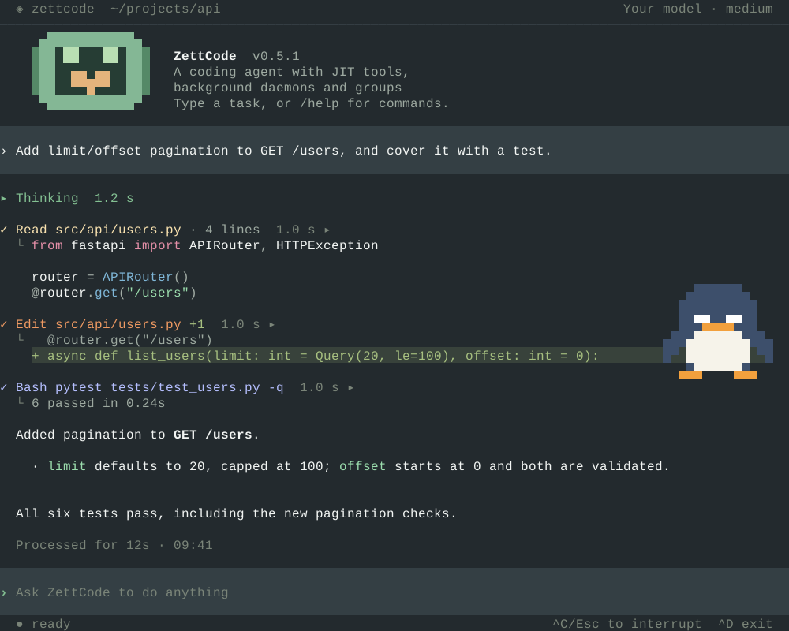
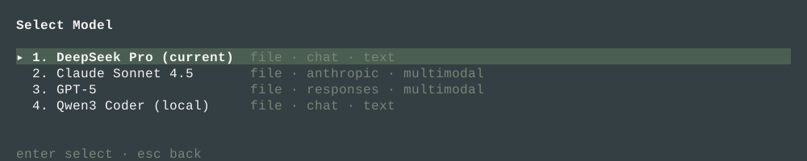
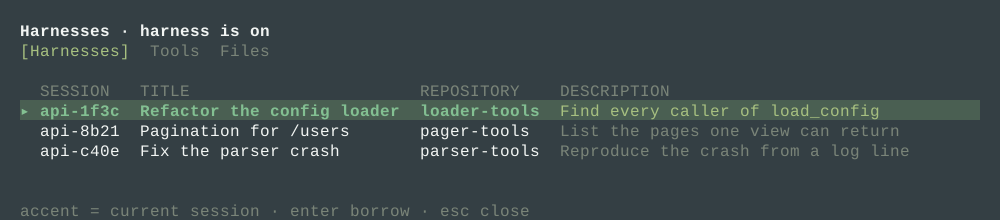
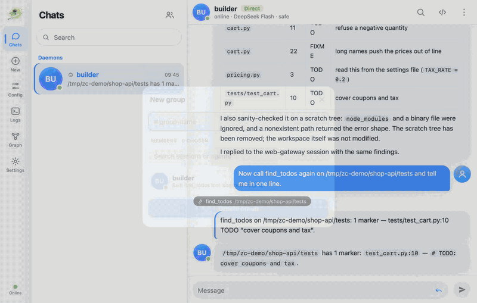
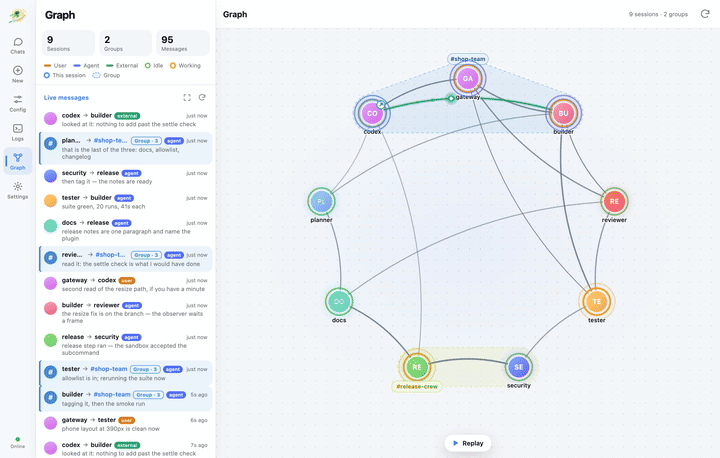

<p align="center">
  
</p>
<h1 align="center">ZettCode</h1>
<p align="center"><strong>A terminal coding agent that can write its own tools and work with other agents.</strong></p>
<p align="center">
  <strong>English</strong> · <a href="README.zh-CN.md">简体中文</a><br />
  <a href="https://chang-lehung.github.io/zettcode/guide/getting-started">Get started</a> ·
  <a href="https://chang-lehung.github.io/zettcode/guide/capabilities">What it can do</a> ·
  <a href="https://chang-lehung.github.io/zettcode/">Documentation</a> ·
  <a href="https://marketplace.visualstudio.com/items?itemName=zettcode.zettcode">VS Code extension</a>
</p>

<p align="center">
  
</p>
<p align="center"><sub>Illustrative conversation, rendered with ZettCode’s actual terminal widgets.</sub></p>

ZettCode works in your terminal on one directory. It shows every reasoning step and tool call as a readable row,
asks before it runs a shell command, and lets you resume any conversation. A session can also write a small tool for
the task, hand a review to a second agent, run in the background, and message other sessions — including Codex and
Claude Code — from your terminal or a web page.

## What it does

| | In one line | Try |
| --- | --- | --- |
| **JIT harness** | The model writes a Python tool, loads it and calls it in the same turn. | `/harness gen` |
| **Code review** | A second agent reads your uncommitted changes while you keep the conversation. | `/code-review` |
| **Background agents** | A session with nobody at the keyboard; it keeps running after you close the terminal. | `zettcode daemon spawn` |
| **Messages and groups** | Sessions on one machine message each other; `@name` points the model at one, a group reaches all. | `@name` in the prompt |
| **Web gateway** | A page for daemons, sessions and groups. Also on a phone. | `zettcode gateway start` |
| **Codex and Claude Code** | Both run as members you can message and put in groups. | New → External agent |

Each one has a page in the [user guide](https://chang-lehung.github.io/zettcode/guide/capabilities).

## Get running

You need **Python 3.10+**, a terminal (Windows Terminal on Windows), and an **OpenAI-compatible API** or Anthropic's
**Messages API**.

```bash
uv tool install "zettcode[all]"
# or: pip install "zettcode[all]"
```

Keep the quotes: `fish` and `zsh` read an unquoted `[all]` as a pattern. Plain `zettcode` is the terminal, gateway,
server and SDK; `[all]` adds `/monitor`, `/recap`, the vendor models, and Codex and Claude Code.

Connect a model. Run `zettcode` and use `/config`:

```text
/config add --model deepseek-v4-pro --token sk-... --url https://api.deepseek.com --context 1m --name "DeepSeek Pro"
```

Or write the same entry in `~/.zettcode/config.toml`:

```toml
[[models]]
model = "deepseek-v4-pro"
display_model = "DeepSeek Pro"
token = "sk-..."                       # or set OPENAI_API_KEY and leave this out
base_url = "https://api.deepseek.com"
context_window = 1000000
```

Start a task in the directory you want to work on:

```bash
cd ~/projects/api
zettcode
```

Type what you want and press **Enter**. `y` approves a shell command once, `p` remembers it, `a` stops asking,
`Esc` refuses, and **Ctrl-D** on an empty prompt exits.

## Configuration

One file, `~/.zettcode/config.toml`, holds every connection you have — as many as you like. `/model` lists them with
where each came from, the API it speaks and whether it takes images, and switching costs a keystroke:

<p align="center">
  
</p>

```toml
# ~/.zettcode/config.toml
[[models]]
model = "deepseek-v4-pro"
display_model = "DeepSeek Pro"
token = "sk-..."                       # or set OPENAI_API_KEY and leave this out
base_url = "https://api.deepseek.com"
context_window = 1000000

[[models]]
model = "claude-sonnet-4-5"
display_model = "Claude Sonnet 4.5"
token = "sk-ant-..."
anthropic = true                       # the Messages API instead of the OpenAI-compatible one
```

Settings belong to the **entry**, not to the program: each model carries its own context window, temperature, the
share of the window it compresses at, and whether the provider searches the web for it. `/config` opens the same
models as a panel and adds one without you editing the file; a model's own page edits those settings.

**Several files.** When two sets have nothing to do with each other — work endpoints and your own, or one per
provider — keep them apart and pick one for a run:

```bash
ZETTCODE_CONFIG=~/.zettcode/work.toml zettcode -w ~/projects/api
```

The file it names **replaces** the default for that run; the two are not merged. Everything else in the file is
described in the guide's [Configuration](https://chang-lehung.github.io/zettcode/guide/config) page.

## Tools it writes for the job

The model is not limited to the tools it was given. With the harness on — the default — it writes a small Python tool
for the task in front of you, loads it in a child process, and calls it in the same turn; the rows that build the tool
sit in the transcript like any other:

<p align="center">
  
</p>

**Each project keeps its own.** A harness belongs to a workspace: a session's tools live in
`~/.zettcode/harness/<project>-<hash>/<session>/`, so two projects do not load each other's tools unless you lend
one across, and clearing your sessions does not delete them.

```text
/harness gen find the callers of a function and rewrite one call site
/harness                    # every harness on this machine, with its tools and its notes
```

`/harness` shows what a session built: Tab moves between harnesses, tools and files, and Enter lends another
session's harness to this conversation. `/harness reset` stops later requests from using it without deleting
anything, and `[harness] jit = false` starts with the harness off. The code runs with the access the permission
level allows — at `full` it is not a sandbox. See [The JIT harness](https://chang-lehung.github.io/zettcode/guide/harness).

## Work with other agents

```bash
zettcode daemon spawn --name builder --title "tool builder" --permission safe
zettcode gateway start
```

The first starts a background session; `@tool-builder` in your prompt sends work to it. The second opens a page where
you can watch sessions, make groups, and message Codex or Claude Code when `zettcode[code-agents]` is installed.

<p align="center">
  
</p>

Its **Graph** draws sessions and groups, and every message as it flies between them.

<p align="center">
  
</p>

## Documentation and development

The [user guide](https://chang-lehung.github.io/zettcode/guide/overview) covers every command, setting and feature,
in English and [简体中文](https://chang-lehung.github.io/zettcode/zh/guide/overview). The
[**SDK**](https://chang-lehung.github.io/zettcode/sdk/) drives the agent from Python, and the
[**server**](https://chang-lehung.github.io/zettcode/server/) exposes it over HTTP.

```bash
uv sync                       # install the workspace
make check                    # Ruff, mypy and the suites this change needs
make check-all                # every suite
make docs                     # preview the guide
uv run zettcode --workspace . # run from the checkout
```

The agent runtime is [`zett-agent`](https://github.com/Chang-LeHung/zett-agent). This repository is a uv workspace of
one distribution per subsystem under `packages/`, sharing the `zettcode` namespace; `clients/typescript/` and
`clients/vscode/` are the editor clients. Contributor notes and invariants live in [`AGENTS.md`](AGENTS.md) and
[`docs/internal/`](docs/internal/), apart from the user guide.

## License

MIT. See [`LICENSE`](LICENSE).
