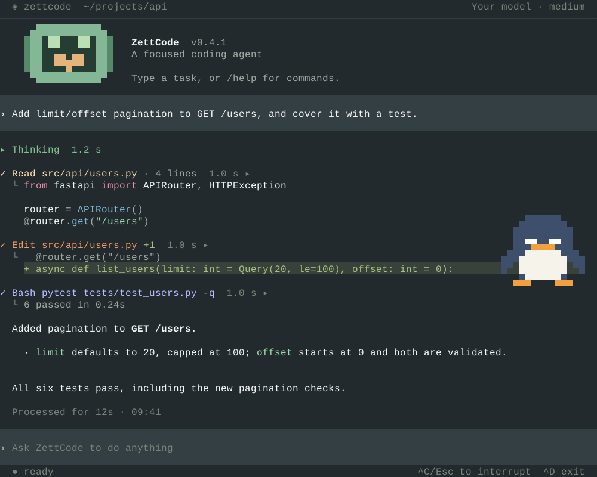
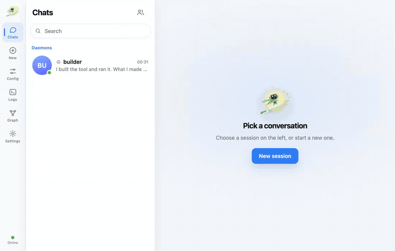
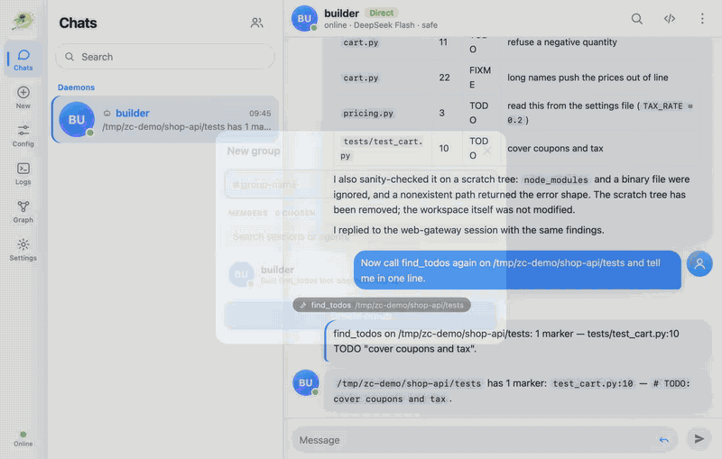
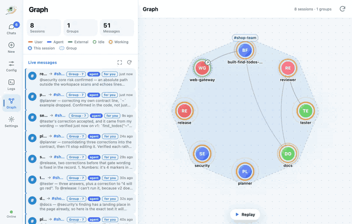

<p align="center">
  
</p>
<h1 align="center">ZettCode</h1>
<p align="center"><strong>能给自己写工具、也能和其他智能体协作的终端编码智能体。</strong></p>
<p align="center">
  <a href="README.md">English</a> · <strong>简体中文</strong><br />
  <a href="https://chang-lehung.github.io/zettcode/zh/guide/getting-started">快速开始</a> ·
  <a href="https://chang-lehung.github.io/zettcode/zh/guide/capabilities">它能做什么</a> ·
  <a href="https://chang-lehung.github.io/zettcode/zh/">使用文档</a> ·
  <a href="https://chang-lehung.github.io/zettcode/zh/guide/commands">命令参考</a> ·
  <a href="https://marketplace.visualstudio.com/items?itemName=zettcode.zettcode">VS Code 扩展</a>
</p>

<p align="center">
  
</p>
<p align="center"><sub>示例对话由 ZettCode 的实际终端组件渲染。</sub></p>

ZettCode 在你的终端里处理一个工作区的文件：思考和工具调用以可读的行呈现，执行 shell 命令前先询问，任何对话都能恢复。
在单个会话之外，它还能给自己写小工具、把评审交给第二个智能体、在后台运行智能体，并让会话互相发消息、共用群，
Codex 和 Claude Code 也包括在内，全部在一个网页里管理。

## 有什么不同

| 能力 | 一句话 | 试一试 |
| --- | --- | --- |
| **JIT harness** | 模型当场写一个小的 Python 工具，在子进程里加载，并在同一轮里调用。 | `/harness gen` |
| **代码评审** | 另一个智能体读你未提交的改动，你的对话不被打断。 | `/code-review` |
| **后台智能体** | 没人坐在键盘前的会话；关掉终端它还在运行。 | `zettcode daemon spawn` |
| **消息、`@` 与群** | 同一台机器上的会话互发消息；`@名字` 让模型找到对方，发给群的消息送达所有成员。 | 输入框里 `@名字` |
| **Graph 页面** | 会话是节点，群是区域，消息沿线飞过，可以回放。 | `zettcode gateway start` |
| **网页网关** | 管理 daemon、会话和群的网页；手机、桌面和 Android 外壳也能用。 | `zettcode gateway start` |
| **Codex 与 Claude Code** | 两者都作为可发消息、可入群的成员运行。 | New → External agent |

[它能做什么](https://chang-lehung.github.io/zettcode/zh/guide/capabilities)里每一项都有一节：它是什么、和单个终端会话有什么不同、该运行什么。

## 先跑起来

需要 **Python 3.10+**、支持 UTF-8 的终端和 **OpenAI 兼容接口**（或 Anthropic 的 **Messages API**）。
支持 macOS、Linux 和 Windows（请使用 Windows Terminal）。

### 1. 安装

```bash
uv tool install "zettcode[all]"
# 或者：pip install "zettcode[all]"
```

请保留引号：`fish` 和 `zsh` 会把没加引号的 `[all]` 当作通配符。单独的 `zettcode` 是更小的安装（终端、网关、服务器、SDK）。
`[all]` 再加上 `/monitor`、`/recap`、官方厂商模型，以及网关里的 Codex/Claude Code；如果只想要其中一部分，
extra 的名字是 `monitor`、`recap`、`models` 和 `code-agents`。厂商模型要在 `[plugins] enable = ["models"]` 里点名才会启用。
Codex 和 Claude Code 还需要各自的命令行工具已安装并登录。

### 2. 连接模型

创建 `~/.zettcode/config.toml`（以及父目录），先配置一个模型：

```toml
[[models]]
model = "deepseek-v4-pro"             # 发给 DeepSeek 的模型 id
display_model = "DeepSeek Pro"        # ZettCode 界面中显示的名字
token = "sk-..."                      # 替换成你的 DeepSeek API key
base_url = "https://api.deepseek.com"  # DeepSeek 的 OpenAI 兼容接口根地址
context_window = 1000000               # 以接入点当前公布的实际限制为准
multimodal = false                    # 这个模型接受文本，不接受图片
```

在 [DeepSeek 开放平台](https://platform.deepseek.com/)创建 API key，不是聊天网页的登录信息。
也可以省略 `token`，改用 `OPENAI_API_KEY` 环境变量保存这个 key。
添加更多 `[[models]]`，就能用 `/model` 切换；启动时默认选择第一项。
完整示例、默认值和排错步骤见[配置参考](https://chang-lehung.github.io/zettcode/zh/guide/config)。

### 3. 发出任务

```bash
cd /path/to/project
zettcode
# 或者：zettcode --workspace /path/to/project
```

描述要改什么，按 **Enter**。`/` 打开命令菜单，`@` 引用 skill 或另一个会话，**Ctrl-C** 停止请求。
输入框为空时按 **Ctrl-D** 退出，终端会打印恢复当前会话的命令。

## 五分钟：逐项试一试

每一步都可以单独做。请在项目目录里运行，第 2 步需要在 git 检出里。

**1. 让模型写一个工具。** 在 ZettCode 会话里：

```text
/harness gen 列出这个仓库里的 TODO 注释，按文件分组
```

模型会在 `~/.zettcode/harness/` 下写一个工具，用 `repo_load` 加载并运行，然后汇报结果。也可以在 `config.toml` 的 `[harness]`
下写 `jit = true`，让每次运行都默认开启。它默认关闭；在 `full` shell 级别下，它写的代码拥有你自己的权限。`/harness reset` 可以再把它关掉。

**2. 让第二个智能体评审改动。** 工作区里有未提交的改动时：

```text
/code-review
/code-review src/api.py 里的错误处理
```

模型会启动（或复用）一个名为 `code-review` 的后台会话，把评审请求发给它，每修完一轮再来一次。评审者运行在你自己的 shell 级别上，
被告知只读不改；这是一句指示，不是沙箱。

**3. 在后台运行一个智能体，并和它对话。**

```bash
zettcode daemon spawn --name builder --title "tool builder" --permission safe
zettcode daemon list
```

然后在终端会话里敲 `@`，从菜单里选它：名字取自标题，所以这里是 `@tool-builder`。

```text
❯ @tool-builder write a helper that lists TODO comments, then tell me its name
```

<p align="center">
  
</p>

daemon 不会问任何人，所以也没人能批准它的命令：`--permission` 默认是 `full`（没有沙箱），也没有 `ask`。
除非这个工作区是你愿意给一个 shell 的，否则请用 `safe`（沙箱）或 `deny`（没有 shell）。
`zettcode daemon stop <session-id>` 会停止它并保留记录。

**4. 打开网关，建一个群，看 Graph。**

```bash
zettcode gateway start
```

打开它打印的地址。**Chats** 列出你的 daemon 和会话；用 **New group** 建一个群，发给群的消息会送达每个在线成员。
**Graph** 把会话画成节点、群画成区域，每条消息沿着它的线飞过，还能回放最多 20,000 条已存的消息。
这个页面在手机上也能用（监听本机以外的地址需要 `--token`，见[网关指南](https://chang-lehung.github.io/zettcode/zh/guide/gateway)）。

<p align="center">
  
</p>
<p align="center">
  
</p>

**5. 加入 Codex 或 Claude Code。** 装了 `[all]`，并且 `codex` 或 `claude` CLI 已在你的用户下登录后：

```bash
zettcode gateway restart
```

在网关里打开 **New**，选 **External agent**（外部智能体）标签，选 Codex 或 Claude Code，可选填要加入的群，点 **Start external agent**（启动外部智能体）。
它们的权限默认是 `full`，`--no-full` 也限制不了它们；要收窄请改 `~/.zettcode/code-agents/config.json`（见
[指南](https://chang-lehung.github.io/zettcode/zh/guide/code-agents)）。

## 按你的方式工作

| | |
| --- | --- |
| **看清每一步** | 思考、回答和工具调用实时呈现为可读的行，不是原始 JSON。 |
| **决定权在你手上** | 执行 shell 命令前先审阅；智能体需要你的决定时，可以选选项，也可以打字回答。 |
| **工作不中断** | 回复过程中直接输入并选择：立刻引导，或排成可编辑、可调整顺序的后续消息；用 `/btw` 问一句，不让它进入后续上下文。 |
| **随时接着做** | `/resume` 恢复对话，`/export` 导出便于阅读的 HTML。 |
| **看懂上下文** | 查看 token 与缓存统计，用 `/context` 检查占用，在需要时压缩。 |
| **接入你的工具** | 项目 `AGENTS.md` 指令、skills、MCP 服务器和 Python 插件。 |

## 找到你的下一步

**[用户指南](https://chang-lehung.github.io/zettcode/zh/guide/overview)** 提供简体中文与
[English](https://chang-lehung.github.io/zettcode/guide/overview) 两个版本。

| 开始 | 单个会话 | 多智能体协作 | 配置与扩展 |
| --- | --- | --- | --- |
| [快速开始](https://chang-lehung.github.io/zettcode/zh/guide/getting-started) | [认识界面](https://chang-lehung.github.io/zettcode/zh/guide/interface) | [会话之间互发消息](https://chang-lehung.github.io/zettcode/zh/guide/messaging) | [配置参考](https://chang-lehung.github.io/zettcode/zh/guide/config) |
| [它能做什么](https://chang-lehung.github.io/zettcode/zh/guide/capabilities) | [命令参考](https://chang-lehung.github.io/zettcode/zh/guide/commands) | [后台 agent](https://chang-lehung.github.io/zettcode/zh/guide/daemons) | [模型与上下文](https://chang-lehung.github.io/zettcode/zh/guide/models) |
| [常见问题](https://chang-lehung.github.io/zettcode/zh/guide/faq) | [代码评审](https://chang-lehung.github.io/zettcode/zh/guide/code-review) · [JIT harness](https://chang-lehung.github.io/zettcode/zh/guide/harness) | [网页网关](https://chang-lehung.github.io/zettcode/zh/guide/gateway) · [桌面端与手机端](https://chang-lehung.github.io/zettcode/zh/guide/app) | [Skills 与 MCP](https://chang-lehung.github.io/zettcode/zh/guide/skills-and-mcp) · [插件](https://chang-lehung.github.io/zettcode/zh/guide/plugins) |
| | [会话管理](https://chang-lehung.github.io/zettcode/zh/guide/sessions) | [Codex 与 Claude Code](https://chang-lehung.github.io/zettcode/zh/guide/code-agents) | [项目指令](https://chang-lehung.github.io/zettcode/zh/guide/instructions) |

嵌入到别处：[**SDK**](https://chang-lehung.github.io/zettcode/zh/sdk/) 用 Python 驱动智能体，
[**服务器**](https://chang-lehung.github.io/zettcode/zh/server/) 把它放到 HTTP 后面 —— 运行中的 prompt 流式返回，
包含会话、审批、steer 和模型切换。VS Code 用户可以安装[扩展](https://marketplace.visualstudio.com/items?itemName=zettcode.zettcode)，
它是建立在同一个服务器之上的侧边栏对话；源码在 [`clients/vscode/`](clients/vscode/README.md)。

## 开发

```bash
uv sync                          # 安装这个包
make check                      # Ruff、mypy、测试与 VS Code 扩展
make client                     # 构建并测试 TypeScript 客户端
make vscode                     # 类型检查、测试并构建 VS Code 扩展
make hooks                      # 每次提交前强制检查 mypy
make demo                       # 浏览终端组件
make docs                       # 本地预览使用文档
uv run zettcode --workspace .    # 从源码运行
```

ZettCode 提供终端应用和它的 HTTP 服务器;智能体运行时来自
[`zett-agent`](https://github.com/Chang-LeHung/zett-agent)。仓库是一个 uv workspace:`packages/` 下每个子系统一个发行包
—— 读者安装的那个程序、它依赖的 engine、控件框架、broker、SDK、server 与 gateway、终端应用,以及插件 API ——
它们共享同一个 `zettcode` 命名空间;插件(`/monitor`、`/recap`、厂商模型和 Codex/Claude Code,都在 `zettcode[all]` 里)也在这里发布。
`clients/typescript/` 是服务器的 TypeScript 客户端,`clients/vscode/` 是基于该客户端的
VS Code 侧边栏。贡献者约定和不变量放在
[`AGENTS.md`](AGENTS.md) 与 [`docs/internal/`](docs/internal/)，不进入用户指南。
本地预览、重新生成效果图的方法见
[`docs/internal/site-design.md`](docs/internal/site-design.md)。

## 许可证

MIT，见 [`LICENSE`](LICENSE)。
