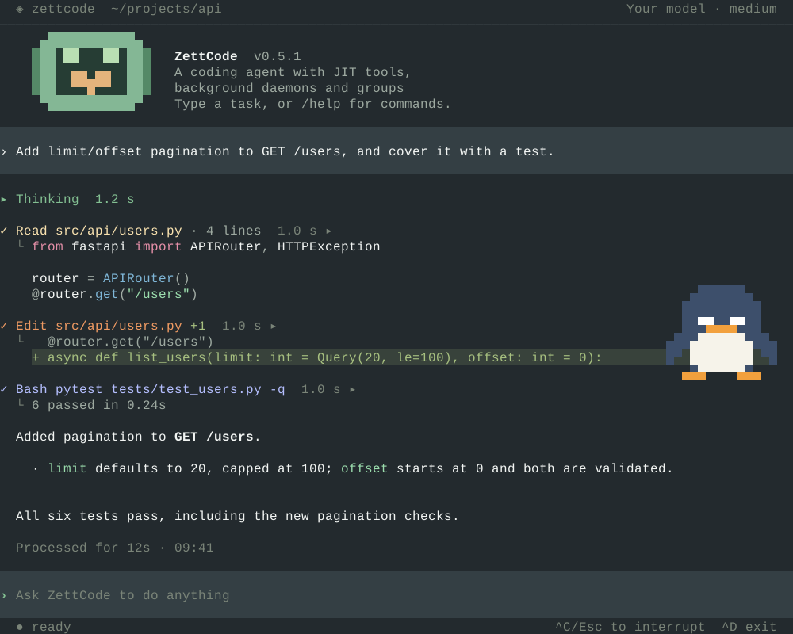
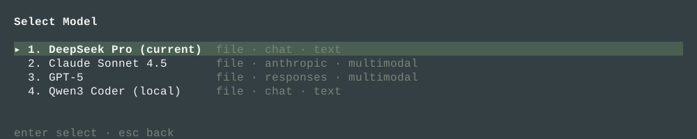
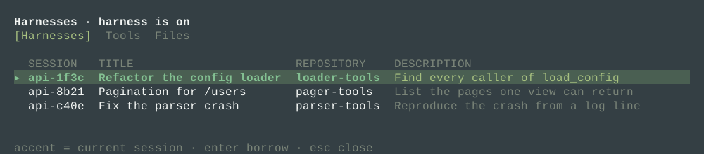
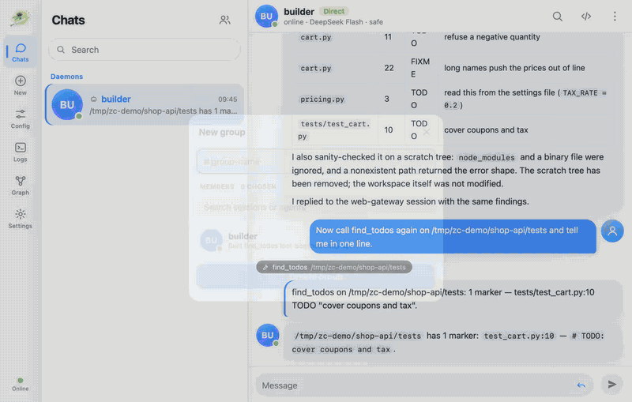
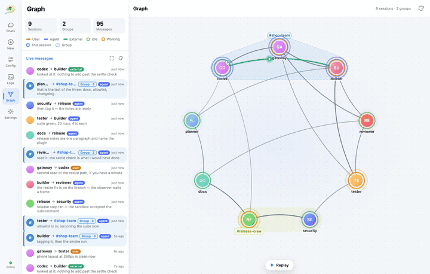

<p align="center">
  
</p>
<h1 align="center">ZettCode</h1>
<p align="center"><strong>能给自己写工具、也能和其他智能体协作的终端编码智能体。</strong></p>
<p align="center">
  <a href="README.md">English</a> · <strong>简体中文</strong><br />
  <a href="https://chang-lehung.github.io/zettcode/zh/guide/getting-started">快速开始</a> ·
  <a href="https://chang-lehung.github.io/zettcode/zh/guide/capabilities">它能做什么</a> ·
  <a href="https://chang-lehung.github.io/zettcode/zh/">使用文档</a> ·
  <a href="https://marketplace.visualstudio.com/items?itemName=zettcode.zettcode">VS Code 扩展</a><br />
  最新发布：
  <a href="https://github.com/Chang-LeHung/zettcode/releases/tag/zettcode-vscode-0.1.9">VS Code 扩展 0.1.9</a> ·
  <a href="https://github.com/Chang-LeHung/zettcode/releases/tag/zettcode-mobile-0.1.1">安卓端 0.1.1</a>
</p>

<p align="center">
  
</p>
<p align="center"><sub>示例对话由 ZettCode 的实际终端组件渲染。</sub></p>

ZettCode 在你的终端里处理一个目录。它把思考和每次工具调用显示成一行行可读的内容，执行 shell 命令前先问过你，
任何对话都能恢复。一个会话还能为当前任务写一个小工具、把评审交给另一个智能体、在后台运行，并和其他会话
互相发消息——包括 Codex 和 Claude Code——从终端或一个网页里都能操作。

## 它能做什么

| | 一句话 | 试一试 |
| --- | --- | --- |
| **JIT harness** | 模型当场写一个 Python 工具，加载后在同一轮里调用。 | `/harness gen` |
| **代码评审** | 另一个智能体读你未提交的改动，你的对话不被打断。 | `/code-review` |
| **后台智能体** | 没人坐在键盘前的会话；关掉终端它还在跑。 | `zettcode daemon spawn` |
| **消息与群** | 同一台机器上的会话互发消息；`@名字` 找到某个会话，群消息送达所有成员。 | 输入框里 `@名字` |
| **网页网关** | 管理 daemon、会话和群的网页，手机也能用。 | `zettcode gateway start` |
| **Codex 与 Claude Code** | 两者都能作为成员收消息、进群。 | New → External agent |

每一项的完整说明见[用户指南](https://chang-lehung.github.io/zettcode/zh/guide/capabilities)。

## 先跑起来

需要 **Python 3.10+**、一个终端（Windows 用 Windows Terminal），以及 **OpenAI 兼容接口**或 Anthropic 的
**Messages API**。

```bash
uv tool install "zettcode[all]"
# 或者：pip install "zettcode[all]"
```

引号要保留：`fish` 和 `zsh` 会把没加引号的 `[all]` 当作通配符。单独的 `zettcode` 是终端、网关、服务器和 SDK；
`[all]` 另外带来 `/monitor`、`/recap`、各厂商模型，以及 Codex 和 Claude Code。

连接模型。运行 `zettcode`，用 `/config` 加一个：

```text
/config add --model deepseek-v4-pro --token sk-... --url https://api.deepseek.com --context 1m --name "DeepSeek Pro"
```

或者把同样的内容写进 `~/.zettcode/config.toml`：

```toml
[[models]]
model = "deepseek-v4-pro"
display_model = "DeepSeek Pro"
token = "sk-..."                       # 也可以改用 OPENAI_API_KEY，把这一行去掉
base_url = "https://api.deepseek.com"
context_window = 1000000
```

在你要工作的目录里启动：

```bash
cd ~/projects/api
zettcode
```

输入任务，按 **Enter**。shell 命令会先问你：`y` 执行一次，`p` 记住这条，`a` 不再询问，`Esc` 拒绝；
输入框为空时按 **Ctrl-D** 退出。

## 配置文件

一个文件 `~/.zettcode/config.toml` 放你所有的模型连接，想放几个放几个。`/model` 打开时每条都写清它是从哪来的、
说的是哪个 API、收不收图片，切换只要一次按键：

<p align="center">
  
</p>

```toml
# ~/.zettcode/config.toml
[[models]]
model = "deepseek-v4-pro"
display_model = "DeepSeek Pro"
token = "sk-..."                       # 也可以只设 OPENAI_API_KEY，把这一行去掉
base_url = "https://api.deepseek.com"
context_window = 1000000

[[models]]
model = "claude-sonnet-4-5"
display_model = "Claude Sonnet 4.5"
token = "sk-ant-..."
anthropic = true                       # 走 Messages API，而不是 OpenAI 兼容接口
```

设置属于**这一条**，不属于整个程序：每个模型带着自己的上下文窗口、温度、在窗口的多少比例上先压缩，
以及这个提供方能不能联网搜索。`/config` 把同一个文件里的模型做成面板，加一条不用你碰文件；
点进某个模型的那一页就是改这些设置的地方。

**多个文件。** 两套连接彼此无关时——公司接口和你自己的，或者每个提供方一套——分开存放，某次运行挑一个：

```bash
ZETTCODE_CONFIG=~/.zettcode/work.toml zettcode -w ~/projects/api
```

它指向的文件在那次运行里**替换**默认文件，两者不会合并。文件里其他内容见指南的
[配置文件](https://chang-lehung.github.io/zettcode/zh/guide/config)一页。

## 为手头的活现写工具

模型不限于已有的工具。harness 默认开着：它会为当前这件事写一个小 Python 工具，在子进程里加载，并在同一轮里调用；
造工具的那些行就和其他行一样留在对话里：

<p align="center">
  
</p>

**每个项目有自己的那一份。** harness 按工作目录（workspace）分开：某个会话的工具放在
`~/.zettcode/harness/<项目名>-<哈希>/<会话>/` 下面，所以两个项目不会互相加载对方的工具（除非你主动借），
清空会话也不会把它们删掉。

```text
/harness gen 找出这个函数的调用方，并改写其中一处调用
/harness                    # 这台机器上所有 harness，以及它们的工具和笔记
```

`/harness` 显示某个会话造了什么：Tab 在 harness、工具、文件之间切换，Enter 把另一个会话的 harness 借给当前对话。
`/harness reset` 之后的请求不再使用它，但什么都不会删；`[harness] jit = false` 让它一开始就是关的。
代码以权限级别允许的身份运行——`full` 下它不是沙箱。详见
[JIT harness](https://chang-lehung.github.io/zettcode/zh/guide/harness)。

## 和其他智能体协作

```bash
zettcode daemon spawn --name builder --title "tool builder" --permission safe
zettcode gateway start
```

第一条启动一个后台会话，在输入框里用 `@tool-builder` 给它派活。第二条打开一个网页，可以查看会话、建群，
装了 `zettcode[code-agents]` 之后还能给 Codex 或 Claude Code 发消息。

<p align="center">
  
</p>

这个页面里的 **Graph** 把会话、群和它们之间飞过的消息画出来。

<p align="center">
  
</p>

## 文档与开发

[用户指南](https://chang-lehung.github.io/zettcode/zh/guide/overview)覆盖每条命令、每个设置和每项能力，也有
[English](https://chang-lehung.github.io/zettcode/guide/overview) 版本。[**SDK**](https://chang-lehung.github.io/zettcode/zh/sdk/)
可以用 Python 驱动智能体，[**服务器**](https://chang-lehung.github.io/zettcode/zh/server/)把它放到 HTTP 后面。

```bash
uv sync                       # 安装工作区
make check                    # 本次改动需要的 Ruff、mypy 和测试
make check-all                # 全部检查
make docs                     # 本地预览文档
uv run zettcode --workspace . # 从仓库里运行
```

智能体运行时是 [`zett-agent`](https://github.com/Chang-LeHung/zett-agent)。本仓库是一个 uv workspace，
`packages/` 下每个子系统一个发行包，共用 `zettcode` 命名空间；`clients/typescript/` 和 `clients/vscode/`
是编辑器客户端。贡献者说明和约束在 [`AGENTS.md`](AGENTS.md) 与 [`docs/internal/`](docs/internal/)，和用户指南分开放。

## 许可证

MIT，见 [`LICENSE`](LICENSE)。
